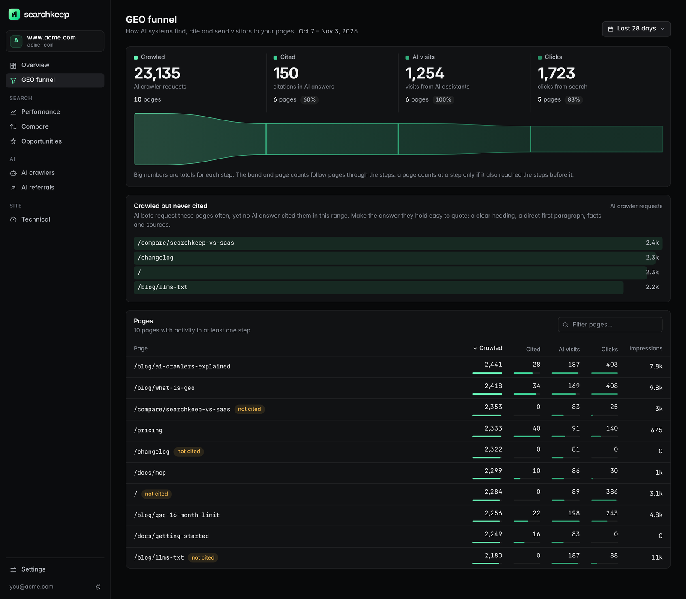
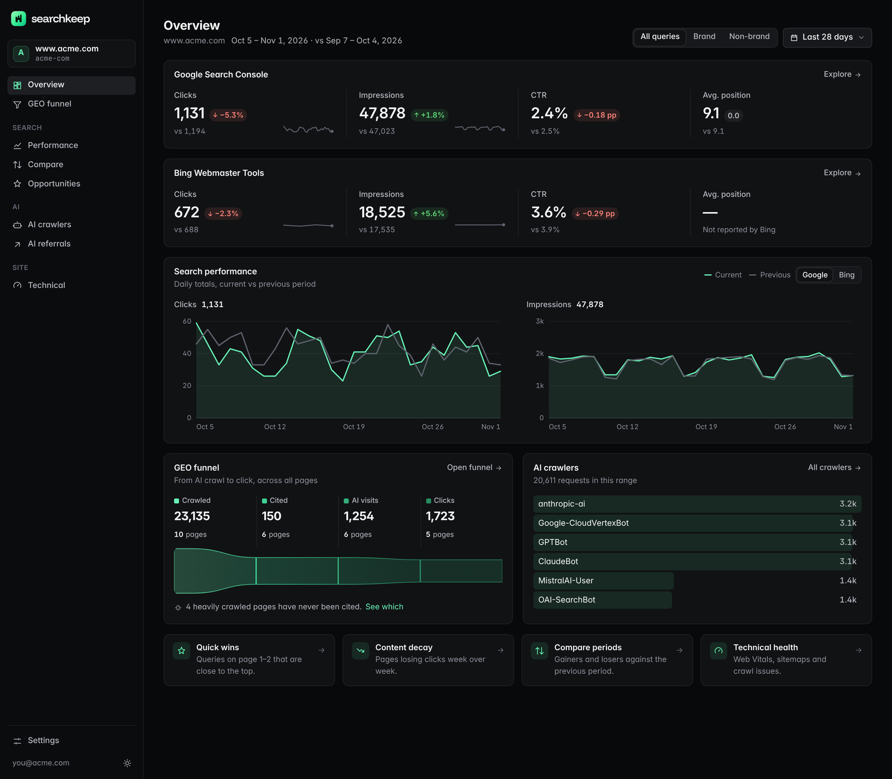

<h1>
  <picture>
    <source media="(prefers-color-scheme: dark)" srcset="docs/brand/logo-on-dark.svg" />
    
  </picture>
</h1>

**Your search data, kept.** SEO and GEO analytics that runs in your own Cloudflare account.

Searchkeep is a self-hosted analytics tool for site owners. It runs as a single Cloudflare Worker
with a D1 database in _your_ account, analyzes only _your_ sites, and uses only first-party data you
already have access to: Google Search Console, Bing Webmaster Tools, and Cloudflare (AI crawler
traffic and Web Analytics).

You use it in two ways over one data layer:

- **Ask** through MCP, from Claude, Cursor, ChatGPT or any other MCP client.
- **Look** through a built-in dashboard.

Website: <https://searchkeep.dev>



## The GEO funnel, connected

Search is no longer just ten blue links. Searchkeep follows each page through the whole path from
AI crawler to visitor:

| Stage       | Question                             | Data source                                                          |
| ----------- | ------------------------------------ | -------------------------------------------------------------------- |
| **Crawled** | Do AI crawlers fetch this page?      | Cloudflare AI crawler requests (by crawler, path and status)         |
| **Cited**   | Do AI answers cite this page?        | Bing AI Performance (imported from its CSV export; it has no API)    |
| **Clicked** | Do people arrive from AI and search? | Web Analytics referrers from AI assistants, plus GSC and Bing clicks |

The `geo_funnel` tool and the dashboard show all three stages per page, next to classic search
performance.



_Screenshots use the built-in demo data (`pnpm dev`, then `POST /api/dev/seed`)._

## Features

- **GEO funnel per page**: crawled, then cited, then clicked.
- **Long-term history**: a sync into D1 every 15 minutes, in small batches, keeps your data for as
  long as you like, well past Google Search Console's 16-month limit. The earlier you deploy, the
  more history you keep.
- **Task-shaped analysis**: quick wins, cannibalization, CTR anomalies, content decay, period
  comparisons, brand vs. non-brand splits.
- **Your data stays in your account**: no telemetry, no vendor server, no third party in the path.
  It runs on the Cloudflare free tier.
- **Read-only by default**: the only write to an external system (`submit_sitemap`) is off until
  you turn it on.
- **Secure by default**: protected by Cloudflare Access, with Managed OAuth for MCP clients
  (dynamic client registration and PKCE). The Worker re-verifies the Access JWT on every request
  and locks itself until Access is set up correctly.
- **Upgrade with one click**: "Sync fork" on GitHub, and Workers Builds rebuilds and deploys; the
  Worker applies new database migrations itself.
- **Agent-friendly**: the deploy guide is an idempotent runbook with a verification for every step,
  so an AI agent can deploy Searchkeep for you.

Not included, by design: backlink data, competitor data, rank tracking and SERP scraping.

## Quick start

1. Fork this repository.
2. Connect the fork to Cloudflare Workers Builds (root directory `apps/cloudflare`, build command
   `pnpm run build`, deploy command `pnpm run deploy`, watch paths `apps/cloudflare/*`,
   `packages/*` and `pnpm-lock.yaml`).
3. Add a custom domain and protect it with a Cloudflare Access application with Managed OAuth.
4. Add your credentials as Worker Secrets.
5. Check readiness on the dashboard's status page, then with the `setup_status` MCP tool. Once it
   is `ready`, the cron syncs every 15 minutes; **Sync now** in the dashboard starts right away.

The full runbook, with click paths, CLI/API alternatives and a verification for every step, is in
**[docs/deploy.md](docs/deploy.md)**. You can hand that file to an AI agent and let it do the work;
the few steps that need a human are clearly marked.

There is no "Deploy to Cloudflare" button on purpose; see
[ADR 0005](docs/adr/0005-fork-and-workers-builds-deployment.md).

**How this deploy path is verified.** The `workers-builds` CI job replays the exact Workers Builds
commands on every change: a fresh `pnpm install --frozen-lockfile` from `apps/cloudflare`, the build
command, and a `wrangler deploy --dry-run`. Before the first release the whole path also ran for real
in Workers Builds, with exactly the settings above: the build installed the workspace, built the
dashboard into the assets, the deploy command tolerated the first (pre-database) migration attempt,
Wrangler created the D1 database from the name-only binding and uploaded the Worker with its assets,
and the retry applied the migration. A deployed Worker served the public setup page, returned
`403 locked` on `/api` and a JSON-RPC lock error on `/mcp`, and rejected forged Access JWTs.

## Architecture

```
                 Cloudflare Access (login + Managed OAuth)
                     │                        │
             dashboard + /api               /mcp            Cron Trigger (every 15 minutes)
                     │                        │                       │
                     └────────── one Worker: apps/cloudflare ─────────┘
                                              │
                                   packages/core (domain + analysis)
                                     │                      │
                          Store interface             Source adapters
                          (packages/store-d1 → D1)    (GSC, Bing, Cloudflare APIs)
```

- **One Worker, three entrances**: the dashboard (and its JSON API), the MCP endpoint, and the
  scheduled sync all call the same core and the same D1 database.
- **Authentication is Cloudflare Access**: the application contains no OAuth server. It verifies
  the `Cf-Access-Jwt-Assertion` JWT against your team domain's JWKS and your application's AUD tag.
- **Lock until ready**: until Access and Managed OAuth are configured correctly and the policy is
  tight, the dashboard only shows a setup guide, the API and MCP refuse requests, and the cron does
  not sync. Each cron pass re-checks Access through the API and locks again if it was loosened.
- **Portable core**: `packages/core` uses only Web standard APIs (fetch, Request/Response,
  WebCrypto). Platform-specific code lives only in `apps/cloudflare` and `packages/store-d1`, so a
  Node runtime or a Postgres store can be added later without rewriting the core.

Routes served by the Worker:

| Route         | What                                                                              |
| ------------- | --------------------------------------------------------------------------------- |
| `/`           | Dashboard (single-page app served as static assets); the setup guide while locked |
| `/setup`      | Setup guide (generic steps only, never shows data)                                |
| `/healthz`    | Liveness check, returns only `{"ok":true}`                                        |
| `/mcp`        | MCP endpoint (Streamable HTTP, stateless)                                         |
| `/api/status` | Readiness state and checks                                                        |
| `/api/*`      | JSON API used by the dashboard (see below)                                        |

The JSON API mirrors the tools: `/api/sites`, `/api/overview`, `/api/performance`, `/api/compare`,
`/api/quick-wins`, `/api/cannibalization`, `/api/ctr-anomalies`, `/api/content-decay`,
`/api/geo-funnel`, `/api/ai-crawlers`, `/api/ai-referrals`, `/api/web-vitals`, `/api/crawl-issues`,
`/api/sitemaps`, `POST /api/inspect`, `/api/setup-status`, `/api/sync-runs`, `POST /api/sync` and
`POST /api/import/ai-citations`. Query parameters use the same names as the MCP tools. Without a
valid Access JWT, `/api/*` returns 403 `{"code":"locked","state":"no_access",...}` and `/mcp`
returns a JSON-RPC error.

The decisions behind this design are recorded in [docs/adr/](docs/adr/README.md).

## Repository map

```
apps/
  cloudflare/          Worker entry (Hono) and wrangler.jsonc
  site/                searchkeep.dev website (SvelteKit; deployed by the project, not by users)
packages/
  core/                Domain model, analysis logic, Store / Auth / Source interfaces
  store-d1/            Drizzle schema, D1 migrations, D1 implementation of Store
  mcp/                 MCP tool definitions (call core only)
  dashboard/           Dashboard UI (Svelte + Vite single-page app)
  sources/gsc/         Google Search Console adapter
  sources/bing/        Bing Webmaster Tools adapter
  sources/cloudflare/  Cloudflare GraphQL Analytics adapter
docs/
  charter.md           Mission and principles (maintainers only)
  adr/                 Architecture decision records
  roadmap.md           Current version scope
  deploy.md            Deploy runbook for humans and agents
  maintainers.md       Repository setup, releases and the website (maintainers)
.claude/skills/maintain/SKILL.md   Automated maintenance loop
AGENTS.md              Instructions for AI agents working on this repository
```

## MCP tools

| Tool                   | What it does                                                                                    |
| ---------------------- | ----------------------------------------------------------------------------------------------- |
| `list_sites`           | Lists configured sites, their connected sources and the date range stored per dataset.          |
| `query_performance`    | Clicks, impressions, CTR and position by date, dimension and filter, from GSC or Bing.          |
| `compare_periods`      | Compares two periods and surfaces the queries and pages that moved most.                        |
| `find_quick_wins`      | Queries ranking 8–20 (by default) with high impressions, ranked by clicks available.            |
| `find_cannibalization` | Queries where several of your pages compete for the same ranking.                               |
| `find_ctr_anomalies`   | Queries whose CTR is clearly below what their position predicts.                                |
| `find_content_decay`   | Pages whose clicks keep declining.                                                              |
| `geo_funnel`           | Per page: AI crawler requests, imported Bing AI citations, AI referral visits and clicks.       |
| `ai_crawlers`          | AI crawler requests by crawler, operator, purpose, path, status or date.                        |
| `inspect_url`          | Live Google Search Console URL inspection.                                                      |
| `list_sitemaps`        | Lists the sitemaps Search Console knows and their status.                                       |
| `submit_sitemap`       | Submits a sitemap to GSC. **Only registered with `ENABLE_WRITES=true`**; needs GSC Full access. |
| `setup_status`         | Reports configuration, readiness and the last sync, so you (or an agent) can verify a deploy.   |

All tools are read-only except `submit_sitemap`. Common parameters: `site`, `start` and `end`
(`YYYY-MM-DD`), `days` (default 28), `source` (`gsc` or `bing`, default `gsc`), `brand` (`all`,
`brand` or `non_brand`) and `limit` (at most 500). Results are aggregated on the server and capped,
so they stay small in your context window. The full parameter reference is at
<https://searchkeep.dev/docs/mcp>.

The "Cited" step comes from Bing AI Performance, which has no API: export its CSV in Bing
Webmaster Tools and import it in the dashboard (**Settings** → **Import AI citations**) or with
`POST /api/import/ai-citations?site=<id>&date=<YYYY-MM-DD>`.

## Principles

Searchkeep is guided by a short [charter](docs/charter.md). In priority order:

1. Your data stays in your own account.
2. Only first-party data you have rights to; no backlinks, competitors or rank scraping.
3. Self-hosted with zero operations: free-tier friendly, upgrade by syncing your fork.
4. Read-only by default.
5. The core does not depend on any platform.
6. Docs are written for agents to execute: every step repeatable and verifiable.
7. Few dependencies; prefer Web standard APIs.

## Contributing

Contributions are welcome. Please read [CONTRIBUTING.md](CONTRIBUTING.md) first. If you work on this
repository with an AI agent, the agent must follow [AGENTS.md](AGENTS.md). Security issues: see
[SECURITY.md](SECURITY.md). Changes and upgrade notes: [CHANGELOG.md](CHANGELOG.md).

To run Searchkeep locally with demo data (dev mode skips Access, for requests to `localhost` only):

```sh
pnpm install
cp apps/cloudflare/.dev.vars.example apps/cloudflare/.dev.vars
pnpm dev                                  # http://localhost:8787
curl -X POST localhost:8787/api/dev/seed  # in another terminal
```

## License

[MIT](LICENSE)
